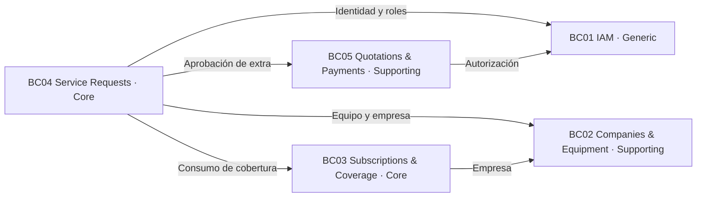
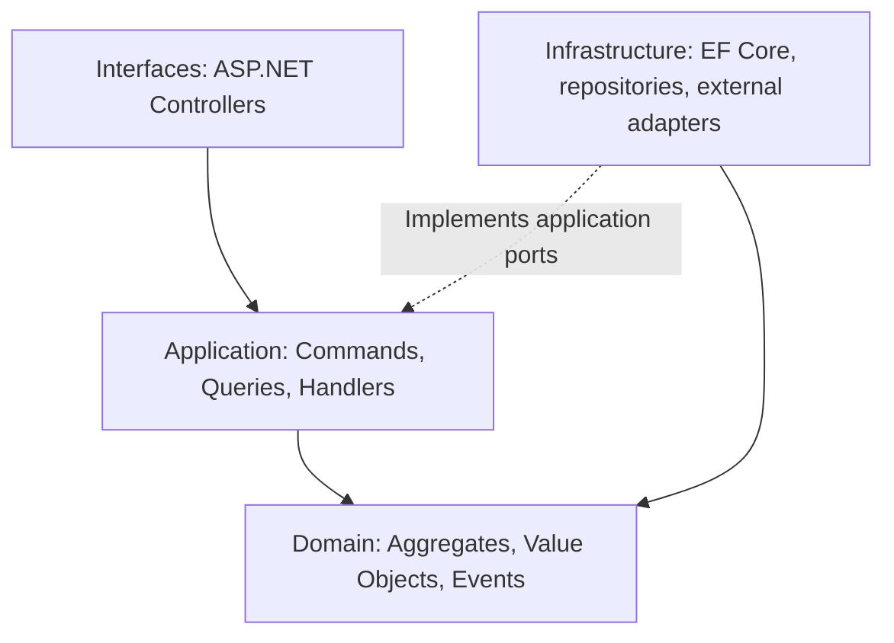

# Especificación arquitectónica DDD — CompuCare

**Equipo:** UniLink  
**Asignatura:** Aplicaciones Web (1ASI0730)  
**Estado:** referencia de diseño que debe contrastarse con la implementación real; no constituye evidencia de un backend ASP.NET Core ya desplegado.  
**Versión de revisión:** AV2, noviembre 2026.

## 1. Decisiones y alcance

CompuCare es una solución de soporte técnico empresarial mediante suscripciones. En DDD se separan dos niveles: **subdominios** (clasificación estratégica del negocio) y **Bounded Contexts** (fronteras dentro de las cuales cada modelo y término tienen significado consistente). Los nombres de los cinco BC y su numeración son los establecidos por el equipo, y **no se deben renumerar al cambiar su orden de presentación**.

| Clasificación | BC | Capacidad y por qué pertenece a esa categoría |
| --- | --- | --- |
| **Core** | **BC04 — Service Requests** | Diferencia el producto mediante el flujo completo de atención de incidencias, diagnóstico e intervención |
| **Core** | **BC03 — Subscriptions and Coverage** | Aplica la promesa comercial de soporte recurrente, horas de cobertura y mantenimiento preventivo |
| **Supporting** | **BC02 — Companies and Equipment** | Mantiene empresas, inventario, sedes y asignaciones de equipos que soportan el servicio principal |
| **Supporting** | **BC05 — Quotations and Payments** | Coordina cotizaciones de extras y registro académico de pagos simulados |
| **Generic** | **BC01 — Identity and Access** | Gestiona usuarios, credenciales, autenticación y autorización, capacidades transversales habituales |

La clasificación es una **decisión de análisis del equipo**, susceptible de refinarse con los resultados de entrevistas y conocimiento del dominio, no una propiedad automática del número de BC.

## 2. Mapa de Contextos y contratos

| Contexto que solicita | Contexto proveedor | Contrato o información necesaria | Regla de integración |
| --- | --- | --- | --- |
| BC04 Service Requests | BC01 Identity and Access | Identidad y rol del solicitante o técnico | El servidor verifica permisos; no confía en permisos del navegador |
| BC04 Service Requests | BC02 Companies and Equipment | Equipo asignado y empresa propietaria | Una persona no puede registrar tickets de equipos ajenos |
| BC04 Service Requests | BC03 Subscriptions and Coverage | Horas disponibles, reserva y consumo | El consumo debe ser idempotente para no descontar dos veces |
| BC04 Service Requests | BC05 Quotations and Payments | Estado de aprobación de cotizaciones adicionales | Un trabajo sujeto a aprobación no puede cerrarse con una cotización pendiente |
| BC03 Subscriptions and Coverage | BC02 Companies and Equipment | CompanyId y equipos incluidos | Cobertura se aplica solamente a la empresa suscriptora |
| BC05 Quotations and Payments | BC04 Service Requests | Identificador del ticket y contexto del diagnóstico | La cotización debe corresponder a una atención válida |
| BC05 Quotations and Payments | BC01 Identity and Access | Identidad del responsable que aprueba o rechaza | Solo un responsable autorizado de la misma empresa decide |

**Regla DDD:** cada agregado debe modificar su propio estado de manera consistente. Un agregado no debe depender de objetos de dominio internos de otro BC; intercambia identificadores, DTOs de lectura o eventos a través de contratos explícitos. En un monolito modular, los límites se pueden expresar con proyectos/capas y puertos de aplicación; no requieren cinco microservicios independientes.



## 3. Agregados, estados y reglas de negocio

### BC04 — Service Requests (Core)

**Raíz de agregado propuesta:** `ServiceRequest`; entidades internas: `Assignment`, `WorkLog` o referencias independientes según las reglas de consistencia.

| Comando | Precondición o invariante | Evento de dominio |
| --- | --- | --- |
| `ReportIssue` | El equipo pertenece a la empresa y está asignado al empleado | `ServiceRequestCreated` |
| `CancelRequest` | Solicitud propia todavía no asignada | `ServiceRequestCancelled` |
| `AssignTechnician` | Ticket pendiente, técnico disponible y con rol válido | `TechnicianAssigned` |
| `StartDiagnosis` | Técnico asignado, ticket en estado Asignado | `DiagnosisStarted` |
| `RecordIntervention` | Diagnóstico, trabajo y tiempo válidos; gastos adicionales autorizados cuando corresponda | `InterventionRecorded` |

Transiciones iniciales propuestas: **PendingAssignment → Assigned → InDiagnosis → Resolved**. Desde PendingAssignment se permite Cancelled. La implementación definitiva deberá precisar si se requieren estados `AwaitingQuotationApproval` y `AwaitingPayment`.

### BC03 — Subscriptions and Coverage (Core)

**Raíz propuesta:** `Subscription`, que gobierna los períodos y saldos de cobertura. `Plan` es el catálogo de beneficios. Para cada período se controlan inicio, vencimiento, horas incluidas y utilizadas, visitas preventivas y alertas de consumo. Los consumos deben tener un identificador de operación para evitar duplicación al reintentar peticiones. El excedente debe manejarse mediante una política explícita, sin dejar que el saldo se vuelva negativo de manera implícita.

Eventos: `SubscriptionActivated`, `CoveragePeriodStarted`, `SupportHoursConsumed`, `CoverageThresholdReached`, `PreventiveMaintenanceScheduled`.

### BC02 — Companies and Equipment (Supporting)

**Agregados propuestos:** `Company` y `Equipment`. `Equipment` conserva `CompanyId`, número de serie, estado y ubicación. La asignación a un empleado debe comprobar que empleado y equipo pertenecen a la misma empresa. Los cambios relevantes forman parte del historial del equipo.

Eventos: `CompanyRegistered`, `EquipmentRegistered`, `EquipmentAssigned`, `EquipmentLocationChanged`.

### BC05 — Quotations and Payments (Supporting)

**Raíz propuesta:** `Quotation`, con líneas `QuotationItem`. Se controla quién puede aprobar, la pertenencia a la empresa, la vigencia y las transiciones `Pending → Approved/Rejected`. Un registro de pago académico **no** representa transferencia bancaria real. El pago simulado solo procede desde el estado permitido por la política comercial.

Eventos: `QuotationCreated`, `QuotationApproved`, `QuotationRejected`, `SimulatedPaymentRecorded`.

### BC01 — Identity and Access (Generic)

**Raíz propuesta:** `UserAccount`. Correo normalizado y único, contraseña almacenada como hash seguro, acceso mediante tokens gestionados con bibliotecas estándar, políticas por rol, vencimiento de sesiones y recuperación de acceso con token de un solo uso. `CompanyId` asocia al usuario con su empresa cuando corresponde; los roles administrativos globales se diferencian de los de la empresa.

Eventos: `UserRegistered`, `UserAuthenticated`, `AccessRecoveryRequested`, `PasswordReset`.

## 4. Arquitectura en capas del backend ASP.NET Core

**Objetivo de diseño, todavía pendiente de implementar como API definitiva:**

```text
src/
  CompuCare.Api/                  # Interfaces / Presentation
  CompuCare.Shared/               # Primitivas mínimas y contratos compartidos
  CompuCare.Iam/
    Domain/                       # Aggregates, Entities, Value Objects, Domain Events, Policies
    Application/                  # Commands, Queries, Handlers, DTOs, Ports
    Infrastructure/               # EF Core, Repositories, Identity adapters
  CompuCare.CompaniesEquipment/
    Domain/
    Application/
    Infrastructure/
  CompuCare.SubscriptionsCoverage/
    Domain/
    Application/
    Infrastructure/
  CompuCare.ServiceRequests/
    Domain/
    Application/
    Infrastructure/
  CompuCare.QuotationsPayments/
    Domain/
    Application/
    Infrastructure/
tests/
  CompuCare.UnitTests/
  CompuCare.IntegrationTests/
```

### Dirección de dependencias

- `Domain` no referencia HTTP, Vue, EF Core, controladores ni repositorios concretos.
- `Application` organiza casos de uso, transacciones y puertos; depende de `Domain` y contratos abstractos.
- `Infrastructure` implementa repositorios, persistencia, autenticación externa, notificaciones y adaptadores.
- `Api` expone endpoints, traduce errores del dominio a respuestas HTTP y configura la inyección de dependencias.
- El frontend Vue está separado por módulos funcionales, pero no debe implementar reglas de negocio como sustituto del servidor.
- Para operaciones que afectan varios agregados se define una política de aplicación, evento de integración o transacción explícita. No se simula atomicidad entre BC sin implementar ese mecanismo.



## 5. Estado contrastado con GitHub

| Requisito | Evidencia encontrada | Estado |
| --- | --- | --- |
| SPA por módulos/BC | `src/iam`, `src/equipment`, `src/subscriptions`, `src/service-requests`, `src/quotations` | Base estructural presente |
| Cliente HTTP por módulo | `iam-api.js`, `equipment-api.js`, `subscription-api.js`, `ticket-api.js`, `quotation-api.js` | Presente |
| Autorización en interfaz | Guardas de Vue Router por `meta.roles` | Presente; no sustituye validación servidor |
| API para demostración | `server/server.js` con Node y JSON Server | Solo desarrollo |
| API definitiva ASP.NET Core / C# | Repositorio separado no encontrado | Pendiente de verificar/implementar |
| Persistencia definitiva | La demo usa `server/db.json`; diagramas proyectan relacional | Pendiente |
| Regla de cotización pendiente | El cierre actual comprueba `t.paused`, no todas las cotizaciones pendientes | Pendiente de corrección |
| Roles | Vue permite también `company_manager`; la demo maneja principalmente `admin` para responsables | Requiere unificar contrato |
| i18n ES/EN | Selector implementado; idioma inicial configurado en inglés | Pendiente auditoría de todas las vistas |

## 6. Pruebas de aceptación DDD prioritarias

1. Empleado A no puede crear tickets para equipos asignados a otro empleado o empresa.
2. Un administrador de la Empresa A no puede ver, aprobar ni pagar cotizaciones de la Empresa B.
3. Un técnico no puede diagnosticar tickets asignados a otro técnico.
4. No se puede cerrar una atención si existe una cotización requerida todavía pendiente de aprobación.
5. Reintentar el registro de una intervención no debe descontar dos veces horas de la suscripción.
6. El vencimiento y renovación del período mensual no deben borrar el historial de atenciones.
7. La recuperación de contraseña debe emitir un token de uso único y limitado en el tiempo, sin exponerlo en la respuesta pública.
8. La consulta de la cobertura debe mostrar las mismas horas consumidas que el sistema registra al concluir una intervención.
9. Los cuatro tipos de usuario deben poder iniciar sesión y solo acceder a funcionalidades permitidas.
10. Las respuestas, documentación y textos visibles deben permitir i18n inglés/español; el idioma inicial de la solución debe ser inglés según el enunciado.

## 7. Artefactos que todavía requieren evidencia del equipo

No corresponde inventar capturas de las sesiones de EventStorming, versiones desplegadas, actas, métricas o pruebas. Se deben agregar el tablero colaborativo original, diagramas de clases con atributos y métodos completos, diagramas ERD reconciliados con migraciones, URLs de Swagger, logs de ejecución, capturas de pruebas de integración, releases y videos reales del Sprint 3 y de validación.
